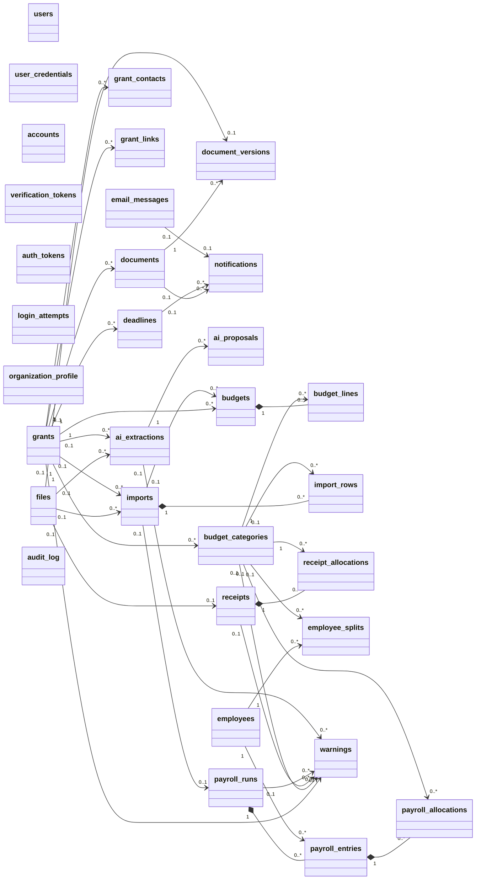
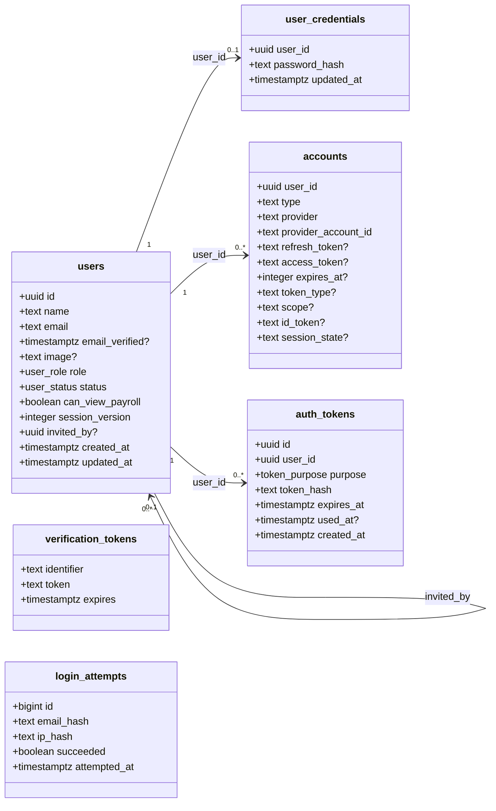
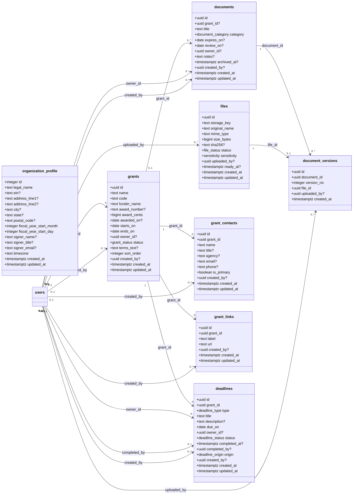
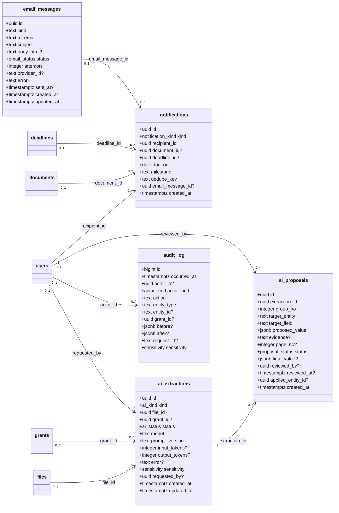
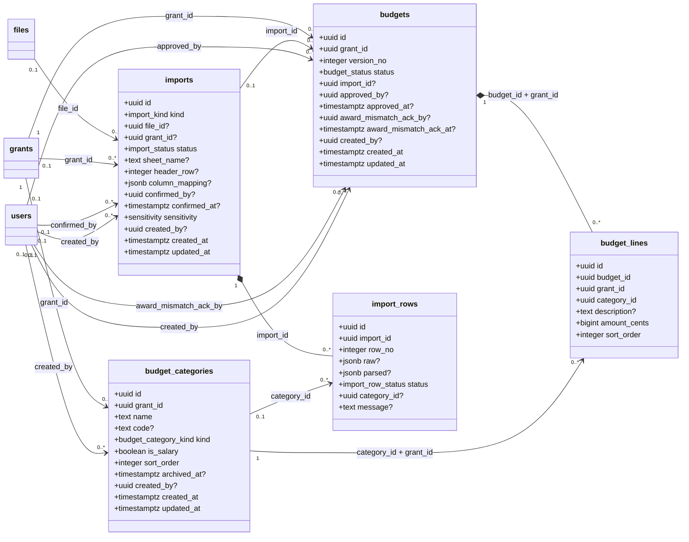
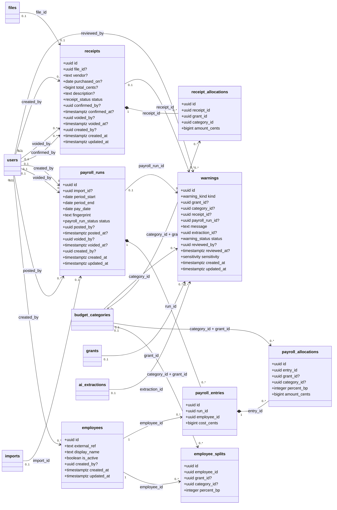

# Database UML

Generated from `src/db/schema` by `npm run docs:uml`. Do not edit by hand.

- A trailing `?` marks a nullable column.
- Multiplicities come from the foreign keys. A filled diamond means child rows are deleted with their parent, which the database permits only for drafts and unconfirmed imports.
- In the detailed diagrams, a class without attributes belongs to another section.

## Overview

All 32 tables. Links to `users` (owner, creator, approver) are left out here and shown in the detailed diagrams.

## Identity

## Organisation, documents, grants and deadlines

## Alerts, AI and audit

## Budgets and imports (Phase 2)

## Receipts, payroll and warnings (Phase 2)

