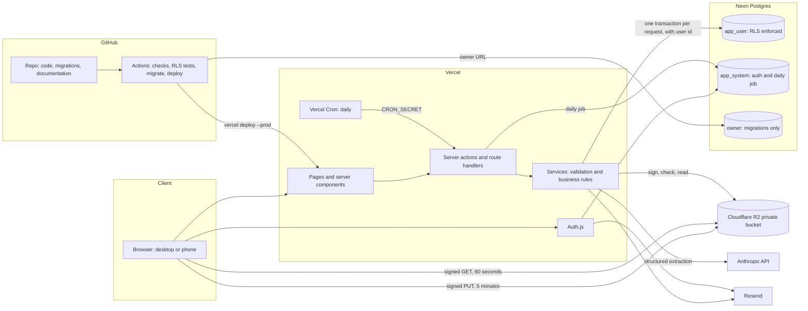
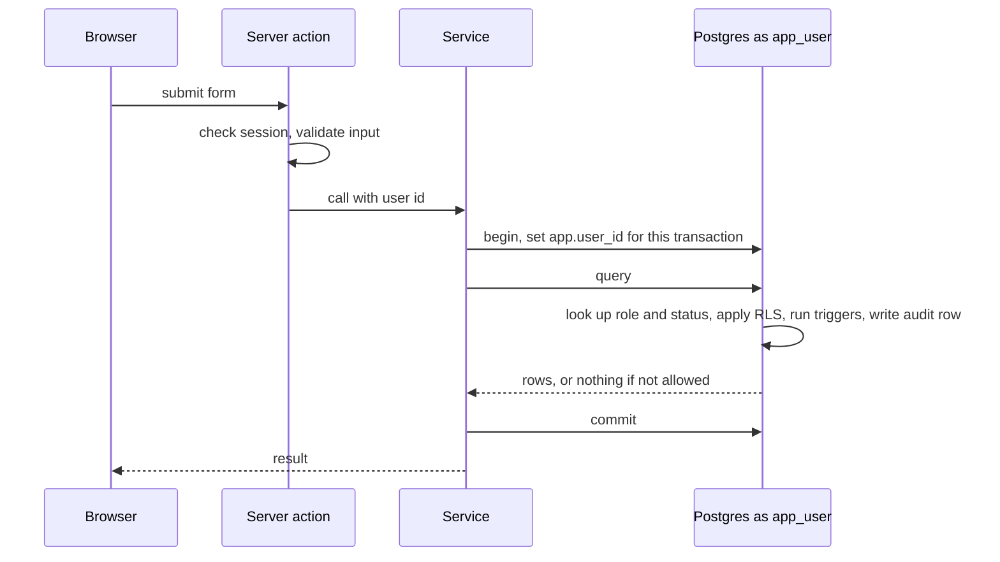

# Architecture

## System diagram

Status: the database, sign-in, email, file storage, and the user, organisation and document services exist. Grants, deadlines, alerts, AI and all screens are designed but not built yet.

## Why GitHub Pages is not the host

Pages serves static files only. It cannot run sign-in, hold an AI key, run the daily job, or keep database credentials away from the browser. GitHub therefore holds the code, migrations and pipeline; Vercel runs the app; Neon holds the data.

## How a request reaches data

The app passes only a user id. The database looks up the role, status and payroll flag itself, so a demoted or deactivated user loses access on the next statement, and a bug in the UI cannot widen access.

## Database connections

| Role | Used by | Where the URL lives | Limits |
|---|---|---|---|
| owner | Migrations and role setup | GitHub Actions secret; never in Vercel | Bypasses RLS |
| `app_user` | Everything a signed-in person does | Vercel | RLS on every table |
| `app_system` | Sign-in, tokens, daily job | Vercel | Named tables only, no payroll, cannot change roles |

`app_user` and `app_system` must be created by `npm run db:roles`. Roles made in the Neon console inherit BYPASSRLS; the script refuses to continue if it finds that.

Identity uses `set_config(..., true)`, which lasts for one transaction, so it is safe behind Neon's transaction-mode pooler.

## Stack

| Job | Tool | State |
|---|---|---|
| App | Next.js, TypeScript, Tailwind, shadcn/ui | Shell installed; shadcn/ui pending |
| Database | Neon Postgres, Drizzle, `pg` | Built; Neon project pending |
| Sign-in | Auth.js, pinned to 5.0.0-beta.32 | Built |
| Files | Cloudflare R2 | Built; tested on an S3-compatible server, R2 account pending |
| Schedule | Vercel Cron | Pending |
| Email | Resend | Built; only outbox mode has been run |
| AI | Anthropic, `claude-haiku-5-5` | Pending |
| Spreadsheets | SheetJS | Phase 2 |
